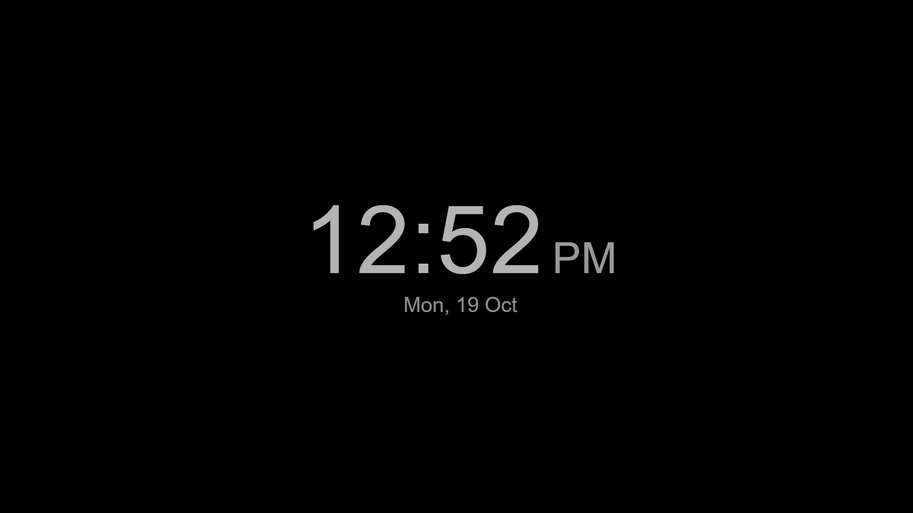

# TV Clock for Samsung Tizen TVs

A full-screen clock and photo screensaver for Samsung smart TVs running Tizen.
Made by **Probably Fine Labs**.



- A clock pill in any corner, or a big centered clock
- A photo slideshow with a slow crossfade and zoom (Bing photo of the day + Lorem Picsum)
- A black background mode with dimmed digits and a small pixel shift every minute
- Stops the TV's own screensaver from taking over while it is open
- Everything is driven by the remote, with no phone app or account

This is a sideloaded app. It is not in the Samsung store, so you install it from a PC
with the TV in developer mode. That takes about 20 minutes the first time.

Tested on a 2025 Samsung QLED (QA43Q7FAAULXL, Tizen 10) from a Windows 11 PC.

## Remote controls

| Button | Action |
|---|---|
| CH ▲ / CH ▼ | Move the clock pill clockwise or counter-clockwise between corners |
| OK | Switch between the pill and a big centered clock |
| ◀ / ▶ | Previous or next photo |
| ▲ / ▼ | Open Settings |
| Back | Close Settings, or exit the app |

Inside Settings, ▲ / ▼ choose a row, OK or ◀ / ▶ change it, and Back closes the panel.
Settings are saved on the TV.

| Setting | Options |
|---|---|
| Background | Photos, or Black (black always uses the big centered clock) |
| Photo motion | On or Off |
| Clock format | 12-hour or 24-hour |
| Photo captions | On or Off |
| Change photo every | 30 sec, 1 min, 5 min or 15 min |
| Photo sources | Bing + Picsum, or Picsum only |

## What you need

- A Samsung TV running Tizen, on the same network as your PC
- A Windows PC. The Python certificate script also runs on macOS and Linux, but the
  deploy script is PowerShell.
- [Tizen Studio CLI](https://developer.tizen.org/development/tizen-studio/download)
  (the "CLI" installer is enough; the TV emulator is not needed)
- Python 3.9+ with the `cryptography` package: `pip install cryptography`
- A Samsung account, which is free. It does not have to be the account on the TV.

## Setup

### 1. Turn on developer mode on the TV

1. Find your PC's IP address (`ipconfig`, look for IPv4 Address).
2. On the TV, open **Apps**, then type **1 2 3 4 5** on the remote's number pad
   (on remotes without numbers, use the on-screen 123 button).
3. Switch **Developer mode** to **On**, enter your PC's IP address and press OK.
4. Restart the TV fully by holding the power button until the Samsung logo appears.

### 2. Install the Tizen CLI

Run the Tizen Studio CLI installer and choose a folder you own, e.g. `C:\tizen-studio`.

The installer asks for administrator rights. If you cannot or do not want to grant
them, it works without them when installed to a folder you own:

```powershell
$env:__COMPAT_LAYER = 'RunAsInvoker'
.\web-cli_Tizen_Studio_6.1_windows-64.exe --accept-license C:\tizen-studio
```

You do **not** need the Tizen Package Manager or the Samsung Certificate Extension.
Without admin rights, the package manager's update step fails part-way and deletes
files from the install. If that happens, reinstall.

### 3. Find your TV's DUID

```powershell
C:\tizen-studio\tools\sdb.exe connect <TV-IP>:26101
C:\tizen-studio\tools\sdb.exe -s <TV-IP>:26101 shell 0 getduid
```

The second command prints the TV's device ID (DUID), something like `7XCMR3DMNEL5C`.
The TV's IP is in its network settings, under Network Status > IP Settings.

### 4. Create a Samsung certificate

Samsung TVs only install apps signed with a Samsung certificate that names the TV.
`tools/make_samsung_cert.py` creates one without Tizen Studio's Certificate Manager:

```powershell
python tools\make_samsung_cert.py <DUID>
```

Pass several DUIDs to cover several TVs with one certificate.

A Samsung sign-in page opens in your browser. After you sign in, the script asks
Samsung's certificate server to sign the certificates. It then writes
`certs/author.p12`, `certs/distributor.p12` and `certs/password.txt`. The `certs/`
folder is git-ignored. Keep it private, because it is your signing key.

If you sign in with Google and the page does not say "Signed in", open the link the
script printed again in the same browser. It goes straight through the second time.

The script needs two Samsung CA certificates, which it downloads once from
download.tizen.org. If that site is down, copy `vd_tizen_dev_author_ca.cer` and
`vd_tizen_dev_public2.crt` from an existing Tizen Studio install with the Samsung
Certificate Extension and pass `--ca-dir <folder>`.

Certificates are valid for one year. To renew one, or to add another TV, run the
script again.

### 5. Register the certificate with the Tizen CLI

```powershell
$env:__COMPAT_LAYER = 'RunAsInvoker'
$pw = (Get-Content certs\password.txt -Raw).Trim()
C:\tizen-studio\tools\ide\bin\tizen.bat security-profiles add -n TVClock `
    -a certs\author.p12 -p $pw -d certs\distributor.p12 -dp $pw
```

### 6. Build and install

```powershell
.\tools\deploy.ps1 -TvIp <TV-IP> -TizenStudio C:\tizen-studio
```

This packages and signs the app, installs it and launches it. TV Clock then appears
in the TV's Apps list. Run the same command again after changing the code.

## Good to know

- **It cannot float over other apps.** Samsung only lets its own apps and partners
  draw over other apps or catch remote buttons in the background, so TV Clock works
  while it is the app on screen.
- **It is not the TV's system screensaver.** It shows photos while it is open, and
  keeps the TV's screensaver from starting during that time.
- **Developer mode.** Apps installed this way usually keep working after developer
  mode is turned off. A factory reset removes them, and a firmware update could
  disable them. To update the app, turn developer mode back on.
- **Photos.** Bing's photos of the day are copyrighted by their photographers (see
  the captions). They are fine for viewing on your own TV, but use "Picsum only" if
  you redistribute or publish the app.

## Troubleshooting

| Problem | Fix |
|---|---|
| `Invalid file or password` when adding the security profile | Check the password in `certs/password.txt`. If the .p12 files came from another tool, they may use AES encryption, which the Tizen CLI's Java cannot read. Re-create them with this script. |
| `Failed to install Tizen application` from `tizen install` | Use `tools/deploy.ps1`. The TV's installer fails on the space in `TV Clock.wgt`, and the script works around it. |
| `sdb connect` fails | Check that developer mode is on, that the IP entered on the TV is this PC's IP, and that the TV was restarted after changing it. |
| App installs but will not launch | The certificate must include this TV's DUID. Re-create it with the right DUID and deploy again. |

## Project layout

```
app/                       The Tizen web app (config.xml, index.html, css, js, icon)
tools/make_samsung_cert.py Samsung certificate creation without Tizen Studio
tools/deploy.ps1           Build, sign, install and launch on the TV
docs/                      Screenshots
```

## Contact

Questions, bugs or ideas: open an issue, or email **mails@imanandhu.in**.

## License

[MIT](LICENSE) © 2026 Probably Fine Labs

## Disclaimer

This is an independent hobby project. It is not affiliated with or endorsed by
Samsung. The certificate script makes the same requests as Samsung's own
Certificate Manager add-on, using your own Samsung account.
